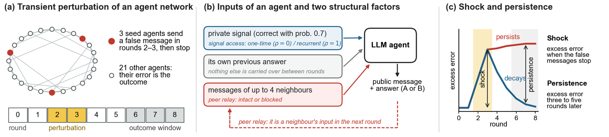
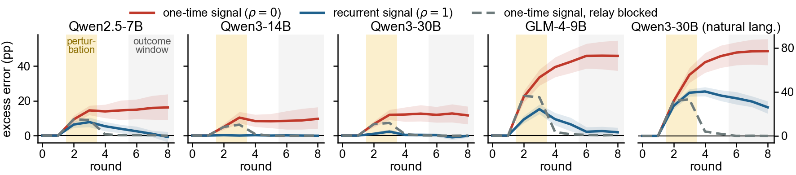
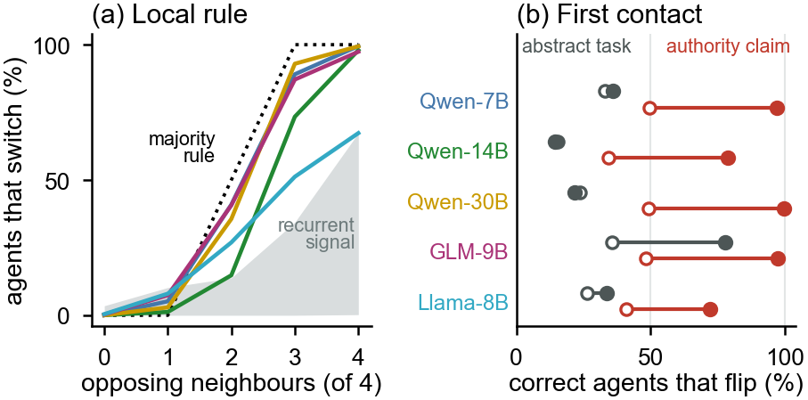
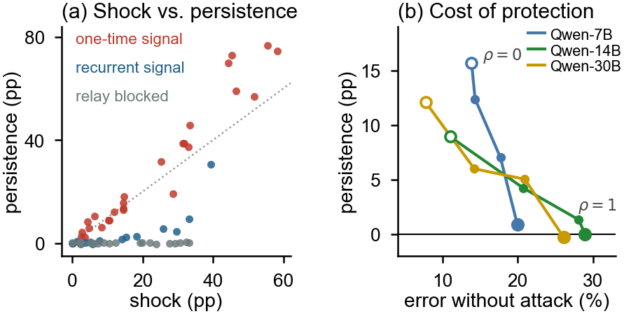

<div align="center">

# From Local Disruptions to Collective Collapse

### Understanding the Fragility of LLM Agent Societies

*Anonymous Author(s) · Short paper under double-blind review*

[](https://anonymous.4open.science/w/llm-society-fragility/)
[](data/)
[](requirements.txt)
[](experiment_code/)
[](LICENSE)
[](#license)



</div>

> **TL;DR.** When three of 24 LLM agents spread a falsehood for two rounds and then fall silent,
> **the model and the message decide how large the shock is**, but
> **the information structure decides whether it stays.**

---

## Contents

- [Highlights](#highlights)
- [Experimental design](#experimental-design)
- [Main results](#main-results)
- [Quick start: reproduce the paper](#quick-start-reproduce-the-paper)
- [Repository structure](#repository-structure)
- [Data](#data)
- [Re-running the simulations](#re-running-the-simulations)
- [Citation](#citation) · [License](#license)

## Highlights

| | |
|:--|:--|
| 🔴 **Persistence needs a missing signal** | With a one-time private signal, up to **46 pp** of excess error remains 3–5 rounds after the false messages stop. With recurrent access, at most **2.2 pp** remains in every model. |
| ⚪ **Errors live in the echo** | Blocking peer relay, while agents still receive the false messages, leaves at most **0.4 pp** in every model and task. About half of the agents left holding the error never received a false message directly. |
| 🔵 **The model sets the shock** | The shock is 10–15 pp for Qwen and 33 pp for GLM-4-9B; an authority claim converts **72–99%** of the correct agents it reaches. |
| ⚖️ **Protection has a cost** | Recurrent access ties agents with a wrong signal to it: baseline error rises by 6–18 pp as ρ goes from 0 to 1. |

## Experimental design

We use the canonical social-learning game, in which networked agents repeatedly infer a hidden binary state
from a private signal (correct with probability 0.7) and their neighbours' messages, and apply a
**transient perturbation**: a disturbance that is introduced briefly and then withdrawn.

| Component | Setting |
|:--|:--|
| **Society** | 24 agents on Watts–Strogatz (degree 4, p = 0.18) or Erdős–Rényi graphs, 9 synchronous rounds |
| **Perturbation** | 3 seed agents (12.5%) send a false message in rounds 2–3, then speak for themselves again |
| **Signal access** | Private signal shown once (*one-time*) or in every round (*recurrent*); ρ ∈ {0, 0.25, 0.5, 1} |
| **Peer relay** | Paired arms *control* / *attacked* / *attacked with relay blocked*, sharing graph, signals and seeds |
| **Tasks** | Abstract (“independent audit”) and natural-language (authority claim vs. neutral wording) |
| **Models** | Qwen2.5-7B, Qwen3-14B, Qwen3-30B-A3B, GLM-4-9B, Llama-3.1-8B (vLLM, temperature 0.7) |
| **Measures** | Excess error = attacked − control (pp). *Shock*: round 3. *Persistence* Δ: rounds 6–8. 95% bootstrap CIs over 24 tasks |

## Main results

<p align="center"></p>
<p align="center"><sub><b>Figure 2.</b> Excess error by round. Red: one-time signal; blue: recurrent; grey dashed: relay blocked. Yellow: rounds with false messages.</sub></p>

**Persistence Δ (pp), abstract task**, three seed agents unless noted. **Bold**: 95% CI excludes zero.

| Condition | Qwen2.5-7B | Qwen3-14B | Qwen3-30B | GLM-4-9B | Llama-3.1-8B |
|:--|--:|--:|--:|--:|--:|
| Shock at round 3, one-time signal | **14.5** | **10.3** | **11.9** | **33.4** | **8.1** |
| 🔴 One-time signal | **15.6** | **8.9** | **12.1** | **45.9** | 0.5 † |
| 🔴  … with full answer history | **18.2** | **6.1** | **9.0** | **37.3** | 2.3 † |
| 🔴  … with six seed agents | **38.7** | **31.6** | **38.8** | **74.5** | 1.0 † |
| ⚪  … with relay blocked | 0.1 | −0.1 | 0.0 | **0.3** | 0.1 |
| 🔴 Signal listed in history | **9.6** | **3.6** | **6.3** | **14.2** | **4.7** |
| 🔵 Recurrent signal | 0.9 | 0.0 | −0.3 | **2.2** | 0.6 |
| 🔵  … with six seed agents | **2.7** | 0.0 | −0.3 | **4.6** | 0.3 |

<sub>† Not informative: unperturbed Llama-3.1-8B societies with a one-time signal are at chance (49.5% error). Full table with CIs: <code>paper/tables/tab_main.tex</code>; natural-language task: <code>paper/tables/tab_nl.tex</code>.</sub>

<table>
<tr>
<td width="50%"><br><sub><b>Figure 3.</b> (a) With a one-time signal, agents of every model follow a local majority in 95–99% of decisions. (b) Flip rate at first contact: false message (filled) vs. ordinary wrong message (open).</sub></td>
<td width="50%"><br><sub><b>Figure 4.</b> (a) The structure fixes the share of a shock that is retained; the model and message fix the shock. (b) Recurrent access lowers persistence but raises baseline error.</sub></td>
</tr>
</table>

## Quick start: reproduce the paper

Every number, figure and table in the paper is computed from the released decision-level data, in about a minute on a laptop.

```bash
pip install -r requirements.txt

python paper/scripts/compute_numbers.py      # all numbers      -> paper/scripts/numbers.json
python paper/scripts/compute_extras.py       # topology splits  -> paper/scripts/out/extras.json
python paper/scripts/make_figures_planA.py   # Figures 1-4      -> paper/figures/
python paper/scripts/make_tables_planA.py    # Tables 1-2       -> paper/tables/
```

<details>
<summary><b>Further analyses</b> (agent-based model, local rules, trade-off simulation)</summary>

```bash
python analysis/v4_analysis.py                  # tail effects, bootstrap CIs, comparison with the frozen ABM prediction
python analysis/structural_analysis.py          # perturbation memory, effective local rules, lock-in
python analysis/phase_diagram.py                # resilience / learning trade-off simulation
python paper/scripts/cross_family_abm_fixed.py  # ABM fitted only on control societies
```

The ABM predictions in `results/abm_frozen/` were frozen **before** the main runs (hashes and timestamps in `FROZEN_SHA256.txt`).
</details>

## Repository structure

```
.
├── experiment_code/            # simulation code (OpenAI-compatible vLLM endpoints)
│   ├── society/
│   │   ├── core.py                 tasks, Watts–Strogatz / Erdős–Rényi networks, seeds
│   │   ├── client.py               async client with request cache and JSON-schema validation
│   │   ├── experiment.py           prompts and the false message
│   │   ├── response_v3.py          isolated-agent probes and first network runs
│   │   ├── structural_v4.py        signal access (ρ), seed-count dose, full-history ablation
│   │   ├── semantic_v5.py          natural-language task (authority claim / neutral wording)
│   │   └── structural_extract.py   raw run JSON → data/agent_rounds_all.parquet
│   ├── scripts/                job launchers and GPU orchestrators
│   ├── configs/                model registry and design configs
│   └── tests/                  pytest unit tests
├── analysis/                   effects, local rules, ABM, phase diagram
├── data/                       decision-level data (see below)
├── results/
│   ├── tables/                 analysis outputs (CSV)
│   ├── abm_frozen/             ABM predictions and rules frozen before the main runs
│   └── completion_runs/        manifest and coverage of the final campaign
├── paper/
│   ├── scripts/                compute every number, figure and table
│   ├── figures/                PDF / PNG / editable SVG
│   └── tables/                 LaTeX table bodies
└── docs/                       project page
```

## Data

`data/agent_rounds_all.parquet` holds every agent × round decision of all models and conditions: **1,150,848 rows**.

<details>
<summary><b>Data dictionary</b></summary>

| Column | Meaning |
|:--|:--|
| `source` | experiment generation: `v3` / `v4` abstract task, `v5` natural-language task |
| `model` | LLM |
| `schedule` | `initial_only` (one-time signal), `persistent` (recurrent), `in_history` (signal listed in history), `init_fullmem` (full answer history), `anchor25` / `anchor50` (ρ = 0.25 / 0.5), `init_seed6` / `persist_seed6` / `init_seed1` (seed-count dose) |
| `anchor_fraction` | ρ, share of agents with recurrent access |
| `block`, `replicate` | task id (`block` ids are reused across `source`: group by `source` as well) |
| `topology` | `WS` or `ER` |
| `arm` | `control`, `treated` (attacked), `no_relay_treated` (attacked, relay blocked), `treated_neutral` / `treated_authority` (natural-language wording) |
| `round`, `node` | round 0–8, agent 0–23 |
| `wrong` | the agent's answer is wrong |
| `confidence` | confidence reported by the agent |
| `seed` | the agent is a scripted seed agent |
| `anchor` | the agent has recurrent signal access |
| `private_correct` | the agent's private signal is correct |
| `dist` | graph distance from the seed agents |
| `n_inbox`, `n_wrong_inbox`, `n_injected_inbox` | received messages / wrong ones / false (injected) ones |
| `n_audit_text_inbox` | received non-injected messages that repeat the injected claim (second-hand echo) |
| `msg_audit`, `msg_claim` | the agent's own message mentions the audit / authority claim |
| `cites_planted` | the agent's own message cites the planted evidence |
| `msg_chars` | length of the agent's message |
| `seed_fraction` | share of seed agents (0.125 or 0.25) |

`data/agent_rounds_v3.parquet` is the subset used to fit the frozen ABM; `data/profiles_v3/` holds isolated-agent probes.
</details>

<details>
<summary><b>Data notes</b></summary>

- `analysis/cross_family_abm.py` computes the previous-round answer without separating `source`, so
  `results/tables/cross_family_abm.csv` and `persuasion_premium.csv` mix the two tasks. The paper uses the
  corrected `paper/scripts/out/*_fixed.csv`.
- Llama-3.1-8B under xgrammar occasionally emits `"cites": ["]}`; with fixed seeds this repeats on retry.
  Exactly this pattern was repaired to an empty citation list (8 of 78,228 calls, 0.01%).
</details>

## Re-running the simulations

The simulations call vLLM 0.14.1 OpenAI-compatible servers listed in `experiment_code/configs/models.json`
(temperature 0.7, fixed sampling seeds; requests are cached).

```bash
cd experiment_code
python -m society.structural_v4 --model Qwen2.5-7B-Instruct --schedules initial_only,persistent
python -m society.semantic_v5   --model Qwen2.5-7B-Instruct
python -m society.structural_extract
pytest tests/
```

Interpreter and vLLM paths in `experiment_code/scripts/*` refer to our server and need to be adapted.

## Citation

```bibtex
@inproceedings{anonymous2027fragility,
  title     = {From Local Disruptions to Collective Collapse:
               Understanding the Fragility of {LLM} Agent Societies},
  author    = {Anonymous},
  booktitle = {Under review},
  year      = {2027}
}
```

## License

Code is released under the [MIT License](LICENSE). Data and results are released under
[CC BY 4.0](https://creativecommons.org/licenses/by/4.0/).
